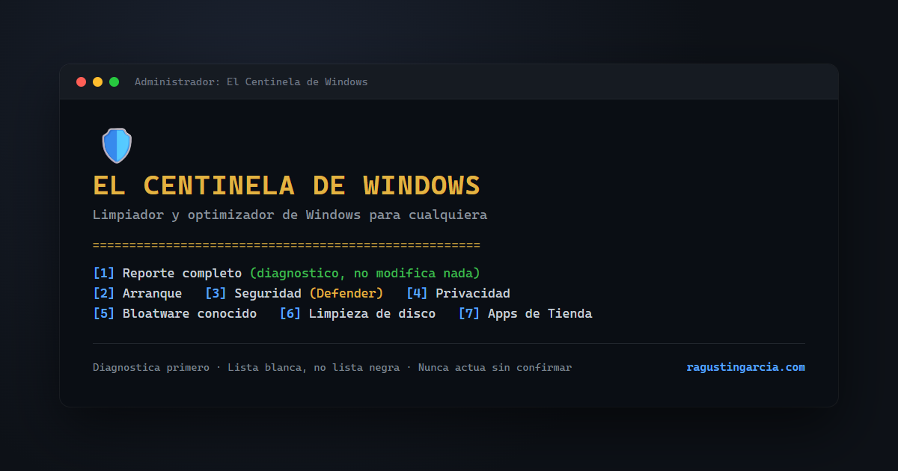

# El Centinela de Windows 0.2.0-rc.2

Release candidata usable de mantenimiento por usuario: diagnóstico de seguridad, reducción de sugerencias/publicidad con respaldo y deshacer, y limpieza de temporales antiguos con vista previa.

## Empezar

Descargar el ZIP de la release, extraerlo completo y abrir `El Centinela de Windows.bat`. Conservar `src` junto al BAT. Usa Windows PowerShell 5.1, sin instalar herramientas ni pedir administrador. Si una consulta exige más permisos, el informe muestra `Unavailable`; no significa que esté todo bien.

1. **Diagnóstico:** Defender, proveedores antivirus, firewall efectivo, escuchas TCP, tareas, servicios, apps y ajustes de publicidad. No modifica configuración.
2. **Privacidad:** vista previa, confirmación exacta, respaldo previo y comprobación de cada valor. Afecta esta cuenta; conservar las fotos de Spotlight. Windows puede restablecer ajustes en actualizaciones o por GPO/MDM. Puede requerir cerrar sesión.
3. **Temporales:** solo archivos de Temp de esta cuenta, creados y modificados hace más de 14 días; nunca borrado recursivo de carpetas. Omite enlaces y rechaza rutas remotas. Cerrar instaladores y aplicaciones primero. El borrado es permanente.
4. **Deshacer privacidad:** elegir el respaldo; conserva valores modificados después por otras apps. Respaldos locales bajo `%LOCALAPPDATA%/Centinela/State`, con acceso restringido.
5. **Exportar al Escritorio:** carpeta nueva con Resumen.txt y Diagnostico.json del último diagnóstico, incluidas advertencias y resultados de acciones. Usa el Escritorio real de Windows, incluso redirigido/OneDrive; puede sincronizarse. No vuelve a escanear ni sobrescribe informes.
6. **Detalle técnico:** consultar el inventario completo cuando haga falta.
7. **Soluciones:** propuestas según los hallazgos. Actualizar firmas, solicitar análisis rápido o activar protección en tiempo real (requiere sesión elevada) cuando Defender está en modo Normal; confirmación individual y comprobación posterior. Firewall y cambios sensibles reciben instrucciones específicas.

## Seguridad y límites

Ejecutar desde la sesión habitual de la cuenta a mantener. No desinstala antivirus, apps, servicios o drivers; no cambia reglas de firewall, RDP, cifrado ni políticas empresariales. Esas operaciones requieren validaciones adicionales y se conservan como tareas guiadas desde Windows.

La detección de proveedores antivirus no prueba su salud. Una escucha local no demuestra exposición a Internet. No certifica ausencia de compromiso, no comprueba todas las CVE/ESU/LTSC y no incluye aún el motor opcional Zero-Breach-Toolkit. Las consultas de Windows no constituyen aislamiento de red.

Esta es una **prerelease**, no una versión estable certificada en toda combinación de hardware/edición. Ver [validación y límites](docs/SECURITY-CANDIDATE.md) y [cambios](CHANGELOG.md).

## Desarrollo y validación

Pruebas aisladas en Windows PowerShell 5.1 y PowerShell 7: `tests/security.tests.ps1`. Prueban registro simulado y archivos/ACL/enlaces reales exclusivamente dentro de fixtures descartables. El uso normal sigue utilizando PowerShell 5.1. Empaquetado reproducible: `python build/package.py DESTINO`.

## Licencia y autor

[MIT](LICENSE). Rodolfo Agustín García ([@ragustingarcia](https://github.com/ragustingarcia)) — [ragustingarcia.com](https://ragustingarcia.com/).
